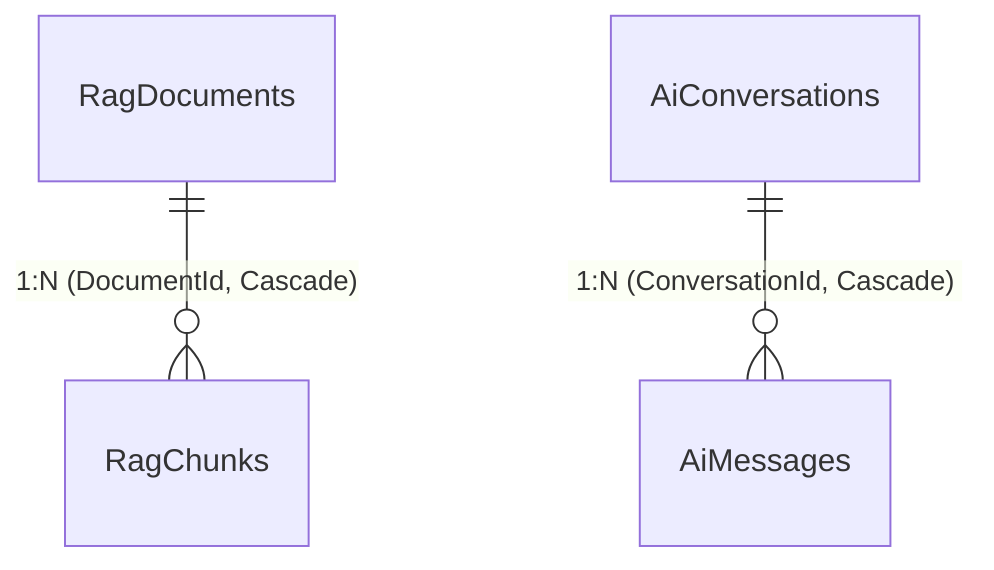

# FPT Alumni Connect — AI Service (`f-alumni-ai-service`)

Dịch vụ Trí tuệ Nhân tạo & Cố vấn Học tập thuộc hệ thống **FPT Alumni Connect** (PRN232 Final Assignment). Được xây dựng theo chuẩn kiến trúc 3 tầng `.NET 10` (`Api -> Services -> Repositories`), ứng dụng kỹ thuật **Retrieval-Augmented Generation (RAG)** kết hợp tìm kiếm ngữ nghĩa, trích dẫn nguồn thực tế, quản lý hội thoại đa lượt, tích hợp Google Gemini API linh hoạt và thuật toán gợi ý cố vấn (Mentor Recommendation).

- **Owner**: Vinh (`vinhmt` — Backend 2)
- **Cổng dịch vụ (Service Port)**: `http://localhost:5004` (Cổng HTTPS: `https://localhost:7004`)
- **Database**: `FAlumni_AiService_Db` (Độc lập 100% — Zero Cross-Database Foreign Keys)
- **Tài liệu ERD Database**: [`docs/ERD.md`](docs/ERD.md)
- **Tài liệu Kiến trúc Hệ thống**: [`docs/ARCHITECTURE.md`](docs/ARCHITECTURE.md) | [`docs/architecture/f-alumni-be2-architecture.svg`](docs/architecture/f-alumni-be2-architecture.svg)

---

## 🗄️ Sơ Đồ ERD Cơ Sở Dữ Liệu (`FAlumni_AiService_Db`)



> Xem đặc tả chi tiết từng bảng, kiểu dữ liệu và chỉ mục tại [`docs/ERD.md`](docs/ERD.md).

---

## 🚀 Toàn Bộ Tính Năng & User Stories Đã Hoàn Thành (AI-01 đến AI-04 + RAG + Mentor)

| Mã US | Tên tính năng & Nghiệp vụ chi tiết | Phương thức HTTP | Đường dẫn Endpoint | Xác thực (Auth) |
| :--- | :--- | :--- | :--- | :--- |
| **AI-01** | Hỏi đáp AI về kinh nghiệm học tập, chương trình đào tạo môn học FPTU | `POST` | `/api/v1/ai/chat` | Bearer JWT |
| **AI-02** | Trả lời chính xác dựa trên tài liệu thực tế cộng đồng FPTU (Grounded RAG, chống lan man hallucination) | `POST` | `/api/v1/ai/chat` | Bearer JWT |
| **AI-03** | Trích dẫn nguồn tài liệu tham khảo (`citations: [{ documentTitle, section, snippet }]`) để kiểm chứng | `POST` | `/api/v1/ai/chat` (Payload trả về) | Bearer JWT |
| **AI-04** | Tiếp tục đặt câu hỏi trong cùng một phiên hội thoại đa lượt (Multi-turn Context qua `conversationId`) | `POST` | `/api/v1/ai/chat` (`conversationId: Guid?`) | Bearer JWT |
| **Mentor** | Gợi ý cựu sinh viên cố vấn theo chuyên ngành, từ khóa kỹ năng và campus | `POST` | `/api/v1/ai/mentors/recommend` | Public / Optional |
| **Lịch sử** | Xem danh sách các cuộc trò chuyện và chi tiết từng phiên hội thoại | `GET` | `/api/v1/ai/conversations`<br>`/api/v1/ai/conversations/{id}` | Bearer JWT |
| **Nạp RAG** | Nạp và đánh chỉ mục tài liệu từ thư mục Word `.docx` (Tự động chạy khi khởi động) | `POST` | `/api/v1/ai/rag/ingest` | Admin (hoặc nội bộ) |

---

## ⚙️ Cấu Hình Khóa Bí Mật & Thay Đổi Model LLM (Không Hardcode Trong Code)

> 💡 **Khẳng định bảo mật**: Toàn bộ source code C# **tuyệt đối không hardcode API Key, Model name hay chuỗi bí mật**. Mọi giá trị đều được inject qua `IConfiguration` theo thứ tự ưu tiên: `Environment Variables` > `appsettings.json` > `User Secrets`.

```json
// src/AiService.Api/appsettings.json
{
  "ConnectionStrings": {
    "DefaultConnection": "Server=localhost\\SQLEXPRESS;Database=FAlumni_AiService_Db;Trusted_Connection=True;TrustServerCertificate=True;"
  },
  "Jwt": {
    "Issuer": "https://identity.falumni.local",
    "Audience": "falumni-services",
    "Key": "",
    "ClockSkewMinutes": 1
  },
  "Gemini": {
    "ApiKey": "",
    "Model": "gemini-1.5-flash"
  },
  "Rag": {
    "DefaultDirectory": "C:\\Users\\vinhmt\\Downloads\\RAG",
    "MaxCitations": 5
  }
}
```

### 1. Cách Thay Đổi Model AI (Không Cần Sửa Code C#)
Khi Google cập nhật model mới hoặc bạn muốn chuyển đổi model, chỉ cần đổi giá trị trong `appsettings.json` hoặc truyền biến môi trường:
- Đổi sang Gemini 2.0 Flash: sửa `"Model": "gemini-2.0-flash"`
- Đổi sang Gemini 1.5 Pro: sửa `"Model": "gemini-1.5-pro"`
- Hoặc đặt biến môi trường:
  ```powershell
  $env:Gemini__Model = "gemini-2.0-flash"
  ```

### 2. Cách Điền API Key Gemini
- **Cách 1 (Biến môi trường - Khuyên dùng)**:
  ```powershell
  $env:GEMINI_API_KEY = "AIzaSy..."
  ```
- **Cách 2 (.NET User Secrets - Khi phát triển cục bộ)**:
  ```powershell
  dotnet user-secrets set "Gemini:ApiKey" "AIzaSy..." --project src/AiService.Api
  ```
- **Cách 3 (appsettings.json)**: Điền trực tiếp vào `Gemini.ApiKey`.

> 🛡️ **Cơ chế Fallback thông minh (Zero-Downtime Guarantee)**:  
> Nếu bạn **không cung cấp API Key**, hoặc gặp lỗi kết nối internet/hết quota Google, AI Service **không bị sập hay báo lỗi**. Hệ thống tự động chuyển sang **Local Grounded Synthesizer**, sử dụng trực tiếp trích đoạn tri thức FPTU đã lập chỉ mục để tạo câu trả lời chính xác, kèm danh sách nguồn trích dẫn đầy đủ.

---

## 🛠️ Hướng Dẫn Chạy & Kiểm Thử Tự Động

```powershell
# 1. Xác minh tính toàn vẹn hợp đồng SHA-256
.\scripts\verify-contracts.ps1

# 2. Chạy toàn bộ 40 Unit & Integration Tests (Bao gồm test nạp dữ liệu Word thực tế)
dotnet test AiService.sln --configuration Release

# 3. Khởi chạy dịch vụ cục bộ trên cổng 5004
dotnet run --project src/AiService.Api/AiService.Api.csproj
```
