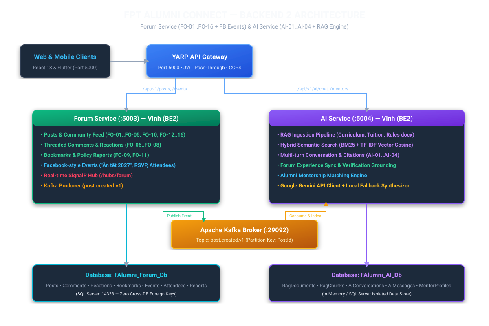
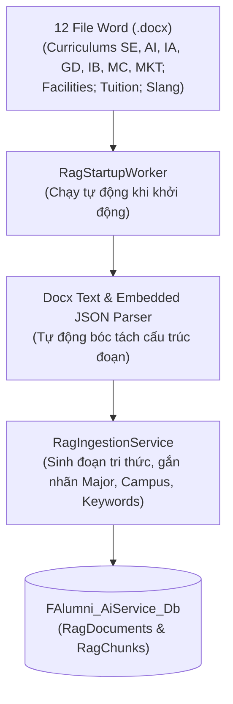
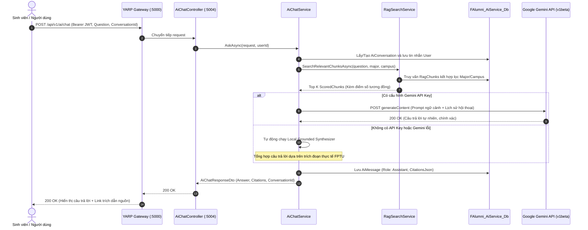

# 🏛️ Sơ Đồ Kiến Trúc Hệ Thống Chi Tiết — AI Service (`f-alumni-ai-service`)

> **Người thực hiện**: Vinh (`vinhmt` — Backend 2)  
> **Cổng dịch vụ**: `http://localhost:5004`  
> **Kiến trúc**: 3 tầng `.NET 10` (`Api -> Services -> Repositories`), Hybrid RAG Retrieval, Gemini LLM API, Local Grounded Fallback Synthesizer, Mentor Recommendation.

---

## 1. Sơ Đồ Kiến Trúc RAG & Tổng Thể Hệ Thống

---

## 2. Đường Ống Nạp Dữ Liệu RAG (RAG Ingestion Pipeline)

---

## 3. Luồng Hỏi Đáp AI Đa Lượt & Trích Dẫn Nguồn (Sequence Diagram)

