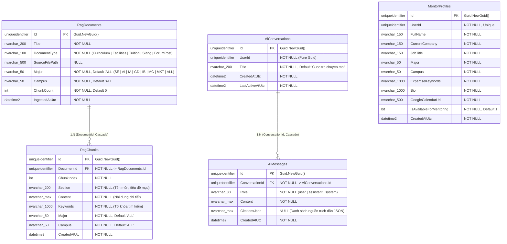

# 🗄️ Sơ Đồ ERD Cơ Sở Dữ Liệu — AI Service (`FAlumni_AiService_Db`)

> **Service**: `f-alumni-ai-service`  
> **Người phụ trách**: Vinh (`vinhmt` — Backend 2)  
> **Cơ sở dữ liệu**: `FAlumni_AiService_Db` (SQL Server + EF Core 10)  
> **Nguyên tắc kiến trúc**: Database-per-Service — Lưu trữ kho tri thức RAG (chunks, embeddings/tags, documents), phiên hội thoại AI đa lượt (`AiConversations`), lịch sử tin nhắn (`AiMessages`), và danh bạ hồ sơ cố vấn (`MentorProfiles`).

---

## 1. Sơ Đồ ERD Chuẩn Mermaid (`FAlumni_AiService_Db`)

---

## 2. Các Chỉ Mục & Khóa Ràng Buộc Tối Ưu Hóa (Indexes)

1. **RagChunks(Major, Campus)**: Giúp lọc tức thì kho tri thức theo ngành học và campus trước khi tính điểm xếp hạng độ tương đồng RAG.
2. **RagChunks(DocumentId, ChunkIndex)**: Đảm bảo thứ tự xuất hiện của các đoạn nội dung trong tài liệu gốc.
3. **AiMessages(ConversationId, CreatedAtUtc ASC)**: Truy xuất toàn bộ lịch sử ngữ cảnh đa lượt (Multi-turn Context) với độ trễ thấp nhất.
4. **MentorProfiles(Major, IsAvailableForMentoring)**: Phục vụ truy vấn gợi ý cố vấn theo chuyên ngành sinh viên.

